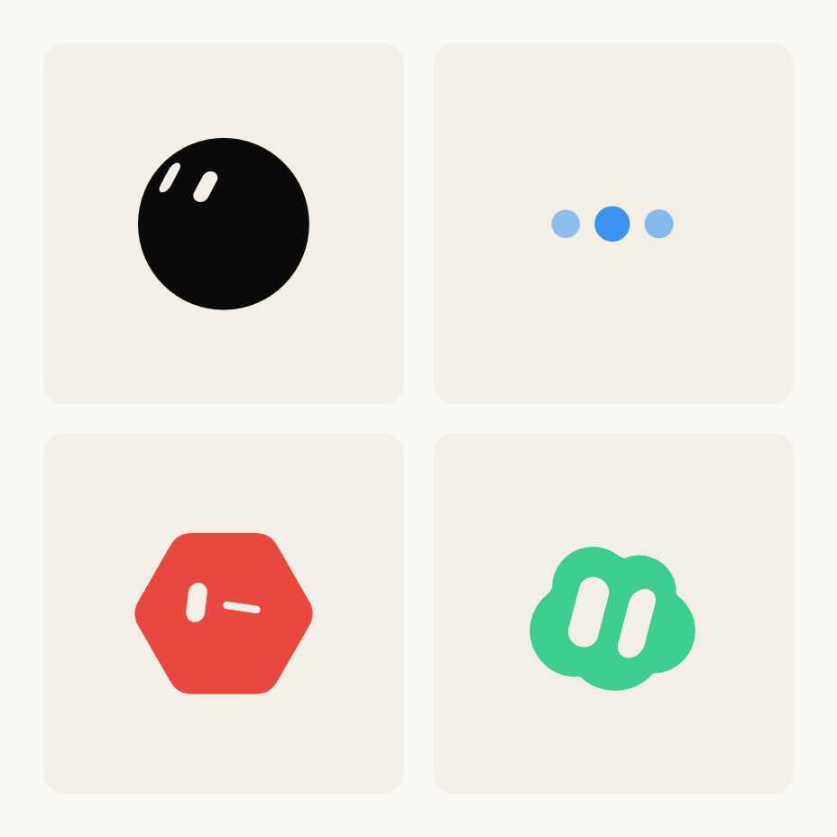
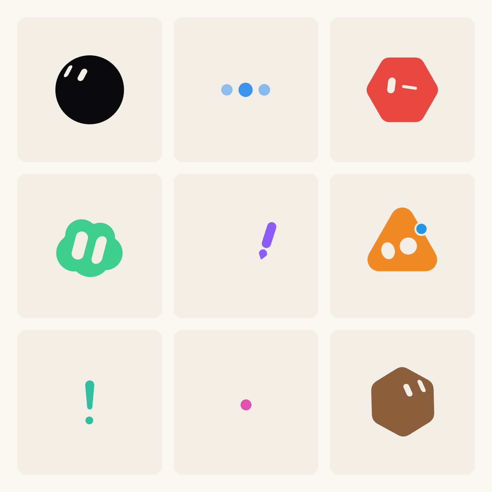
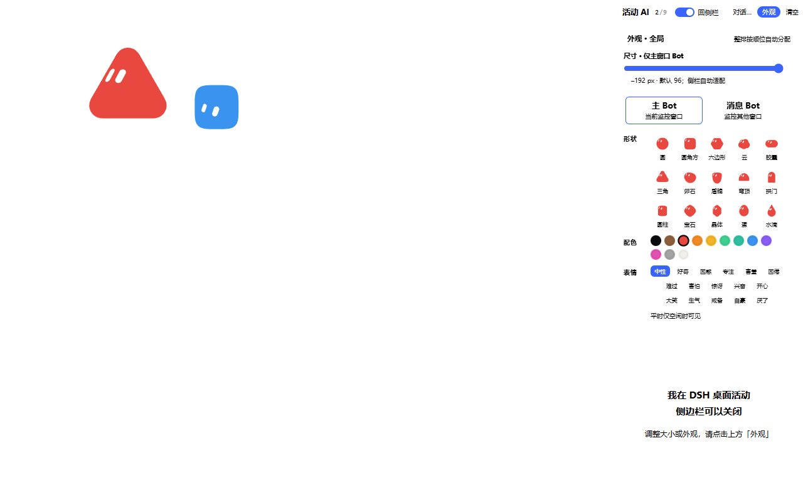

# dsh-agents-bot

> 给 [DeepSeek Harness](https://github.com/deepseek-ai/deepseek-harness) 的**活动 AI 头像插件**：把每个 agent / 子代理正在做的事，画成一眼能看懂的动画小 Bot，并可同时监视多个会话。
> 本仓库是插件本体与构建/验证脚本；不含任何运行时第三方依赖，也不含 DSH 本体。

---

## 它长什么样

- **右栏（侧栏模式）**：一个跨站隔离画面，1～9 格并排，每格一只 Bot 对应一个被监视的会话。
- **主窗口模式（DSH 界面模式）**：DSH 主窗口浮层里的「主 Bot + 消息 Bot」，可拖动、可点击，与右栏显式互斥（同一时刻只运行一套活动画布）。

两种模式共用同一套数据（监视队列、活动推导、外观配置）与同一套引擎，不各维护一份状态。

### 截图

> 1 / 4 / 9 格为**离线引擎渲染的静态帧示意**（每格取不同的身形、配色与活动状态，用来展示「各格长不一样」这一常态）；主窗口模式图为离线测试的合成预览。均非真机聊天界面截图。

| 1 格 | 4 格 | 9 格 |
|---|---|---|
|  |  |  |

**主窗口模式（DSH 界面模式）**：

---

## 特色

### 渲染隔离：不占 DSH 父页面主线程

右栏画面跑在一个**跨站 iframe**里。Chromium 的 Site Isolation 会把跨站 iframe 放进**另一个 renderer 进程 / 另一条主线程**（在已测 DSH Desktop 上，切换时 renderer 数 `2→3→2→3`），因此九格连续动画**不占用 DSH 父页面的主线程**。

> 准确的边界：这是「绘制隔离」的证据，仍共用 DSH 内置的 Chromium/Electron 与整机 CPU/GPU/内存；**聊天流式 p95/p99 的改善尚未量化**，不从进程数推断延迟收益。插件没有、也不需要另装浏览器内核。

### 多对话监控：1～9 格共享队列

- 最多同时监视 **9 个会话**，容量按需伸缩：勾选其它对话扩一格，取消则缩一格，上限 3×3。
- **当前会话恒在首位**，不用勾、不能取消；只切换对话不会偷偷扩容，也不会为每个会话留独立名单。
- 真实会话标题、当前活动、子代理数量都在父侧读取；子代理计数走 `countDescendants`，普通 fork 不算子代理。
- 格数由容器朝向自动推规格（横/竖容器各有 1×1 ～ 3×3 的排布表），带死区防抖。
- 长时间后台后回到前台可自动恢复；首帧握手完成前不展示真实子画面。

### 两种展示形态，显式互斥

| | 侧栏模式 | 主窗口模式 |
|---|---|---|
| 位置 | DSH 右栏页签（跨站隔离画面） | DSH 主窗口 `shell.overlay` 浮层 |
| 内容 | 1～9 格监视队列 | 主 Bot + 消息 Bot（一大一小） |
| 交互 | 父侧控件（监视/外观/设置） | 可拖、可点；大小 64–192px 可调 |
| 切换 | 顶部唯一双态开关，显式切换 | 同开关回到侧栏 |

主 Bot 展示当前会话的真实标题/活动/待处理提醒；消息 Bot 汇总其它被监视会话的待处理项，空闲时零胶囊。侧栏停绘时以静态占位取代，不出现第二套持续动画。

### 多档帧率

- 设置页提供 **45 / 60 / 90 / 120** 四档（默认 60），整个面板共用一档，坏值回落 60。
- 明确标注「这是重画上限，不是物理屏幕实际帧率」；`prefers-reduced-motion` 下降级为静止。
- 卸载或切走后停止重画；主窗口双 Bot 共用**一条共享帧泵**与一组指针监听，不新增第二套持续 rAF。

### 纯函数动画引擎（可冻结、可单测、零依赖）

- 引擎是 `sample(t)` 的**时间纯函数**：单帧可冻结、状态检阅板可复现、无 DOM 也能单测。
- 23 态动画目录 + 轮播调度 + 停留时长；彩球 / 彩线（渐变填充带）/ 环三族材质各自独立。
- 14 种身形、12 配色、16 表情；逐格可独立设外观，另有顺位预设自动给第 2～9 格分配不同形象。
- 眼睛贴合、形状 morph、鼠标追视、减动效降级均为纯数值判据，附离线回归脚本。

### 安全边界：严格握手，失败即拒

- 每 iframe 有随机归属能力标记 + `nonce`/`epoch`；父→子只走 `postMessage`，按**来源、序号、期限、字段白名单**传不透明 id 与展示状态。
- 首次合法 ACK 前子画面 `display:none`；非法归属 **fail closed**，不自动放宽校验，不向子页传真实会话 id / 标题 / 对话正文 / 工具输入输出。
- 快照大小、活动白名单、动画白名单都在协议层钉死；可恢复断连在前台有限等待后重挂载，不复用旧像素/时钟/握手结果。
- 本机静态资源只绑定 `127.0.0.1:49383` 的三项白名单，绑定失败 fail closed；不新开公网监听。

### 工程可复现性

- Host 半侧是零依赖的投影单元，挂 `sessionProjections`，按 key 增量推送；无关事件返回同一 state 引用。
- 构建产出**成对的五文件**（`lib/index.js`、`lib/client.js`、`offscreen/{index.html,app.js,owner.js}`），必须成套替换，配套 SHA-256 清单与 `-CheckOnly` 回退干跑。
- 自带离线验证套件：引擎/投影冒烟、隔离协议与浏览器回归、形状/外观/设置页版式、性能探针。判据口径是「能被脚本钉死的，不靠看着像对的」。

---

## 上游与授权

本项目的**动画引擎**基于 [bloub](https://github.com/jeremy-prt/bloub)（Jérémy Perret，MIT）：`plugin/src/bot/` 由 bloub 的 `src/bot/` 原样引入，其 MIT 许可原文保留在 [`plugin/LICENSE-bloub-MIT.txt`](plugin/LICENSE-bloub-MIT.txt)。bloub 的 MIT 只覆盖其代码，不覆盖它模仿的设计。

本项目**没有复制** [grok-icon-study](https://github.com/wcccheryl/grok-icon-study) 的源代码文件，本仓库不含其文件。但开发过程中**曾参考**其 `animation.html`：借鉴了状态命名语义（reading → thinking → typing 的响应生命周期），并从中转换了 6 个身形的几何轮廓数据（盾牌 / 穹顶 / 拱门 / 圆柱 / 宝石 / 晶体，见 `plugin/src/client/look.ts` 与 `plugin/src/bot/skins.ts`）、参照过其动画参数。

该仓库**未给开源许可**，注明「仅供学习参考，请勿商用或再分发」，角色、商标、几何数据归 xAI / 相应权利人所有。上述几何数据属于参考转换结果，不是其原始代码；如需商用，请自行评估授权。

**本仓库其余代码按 MIT 授权**，见 [LICENSE](LICENSE)。

> 这不是「两个上游仓库合并」：bloub 是引擎本体，grok-icon-study 是设计与语义参考，零行代码被复制。

---

## 目录

```
plugin/          插件本体（唯一源码）
  src/bot/       纯函数动画引擎（来自 bloub，本地扩展 overlay.ts）
  src/host/      Host 半侧：活动投影单元 + 本机静态资源
  src/client/    右栏面板、主窗口叠层、监视队列、设置页、外观
  src/isolation/ 跨站子页与协议
  lib/           构建产物（成对五文件，DSH 实际加载）
  test/          离线回归与浏览器测试
tools/           构建与验证脚本（esbuild 打包、探针、截图）
package.json     构建依赖清单（插件本体零运行时依赖）
```

## 构建

需要 Node 20+。构建依赖只挂在**工作区级** `package.json`，插件本体 `dependencies` 为空是设计要求。

```bash
npm install
node tools/build.mjs                 # 生成 plugin/lib/ 五文件
cd plugin && npm test                # 离线回归
```

> `plugin/lib/` 是 DSH 实际加载的产物；改 `src/` 后必须重新构建，且需**完整退出 DSH 再启动**（Host 半侧在进程启动时加载，刷新页面不生效）。

## 状态

- 模块 1（右栏隔离面板、1–9 格监视、握手/ACK）已完整交付。
- 模块 2（主窗口双 Bot）功能开发完成并装机；真实 Desktop 故障恢复与连续流式成对性能的原始证据仍在补齐。
- 模块 3（Windows 全桌面无边框 Bot）为调研结论：当前 DSH 版本未提供插件可用的 OS 窗口正式入口，未立项。

详见仓库内文档与各模块交接说明。

## 适用范围

这是 DSH Desktop 的第三方插件，依赖宿主公开的 slots / 会话投影 / 右栏导航等扩展点；不修改 DSH 本体、不改全局 CSP、不关闭 `webSecurity`。
